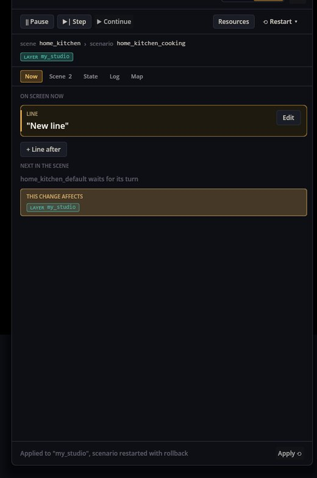
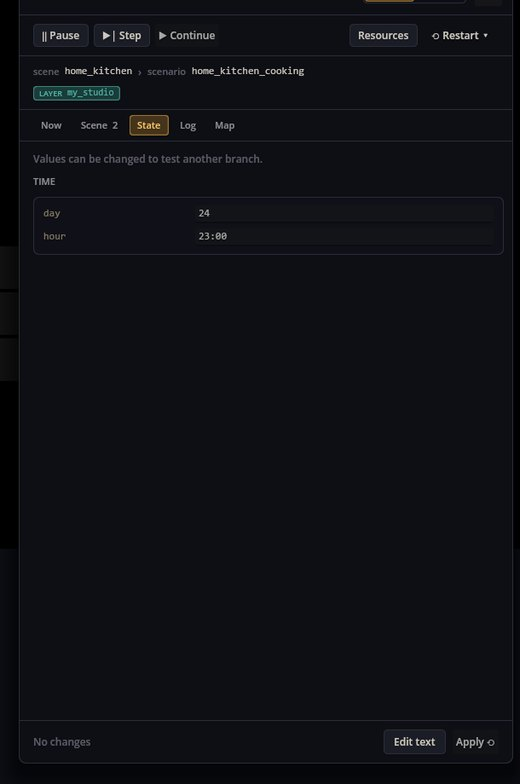
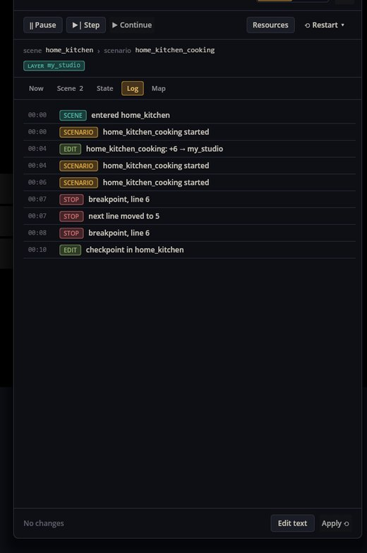

# Scenario Studio — отладка и правка сценариев прямо во время игры

Scenario Studio — это панель рядом с запущенной игрой, которая показывает, какой сценарий играет и какая строка сейчас на экране. Она умеет ставить диалог на паузу, идти по нему строка за строкой, останавливаться на точках останова, переносить следующую строку, перезапускать сценарий с откатом состояния игры и менять сценарий на ходу — и тут же показывает изменения в игре.

Режима два: **Новичок** показывает сюжетный момент простыми блоками, **Автор** — текст сценария с номерами строк.

## Как открыть

У игры, в которую входит набор Developer Tools (механика *Scenario Studio*), на панели инструментов есть кнопка **Студия** — перо. Флаг запуска `--studio` открывает панель сразу при старте. Снимки ниже сделаны на кухне Cthangover; правки уходили в тестовый слой, а не в файлы самой игры.

## Режим «Новичок»

Вкладка **Сейчас** показывает момент на экране: реплику, вопрос и все ответы с тем, куда каждый ведёт. **Изменить** правит текст, **Выбрать, куда** меняет, куда ведёт ответ (метка, другая сцена, конец), **+ Реплика** и **+ Вариант ответа** добавляют к моменту. У каждой правки блок **Изменение затронет** показывает, в какой мод или слой она попадёт.

## Режим «Автор», пауза и точки останова

- **Пауза** задержит диалог перед следующей строкой; **Шаг** выполнит одну строку; **Дальше** продолжит.
- Клик на поле слева ставит **точку останова**: диалог остановится перед этой строкой.
- Перетаскивание маркера **▶** на другую строку назначает её следующей.
- **+ Реплика**, **+ Выбор**, **+ Переход в сцену** добавляют после текущей строки; **Править текст** правит весь сценарий.

## Применение и перезапуск

**Применить** записывает правки и перезапускает сценарий. Здесь перед вопросом добавлена реплика «Новая реплика»; после применения она на экране:

**Перезапуск** предлагает: прогнать сценарий заново без отката, прогнать заново **с откатом состояния** (флаги, предметы, часы и остальное вернутся к тому, как было при старте сценария), заново войти в сцену или продолжить с текущей метки.

## Осмотр состояния

Вкладка **Состояние** показывает состояние игры по владельцам: часы, переменные идущего диалога, задания, на которые ссылается сценарий, инвентарь и какие сценарии уже выполнялись. Переменные, количество предметов и статус заданий можно менять (Enter записывает их в игру), чтобы попробовать другую ветку. Вкладка **Сцена** перечисляет сценарии текущей сцены, **Карта** показывает сцены и пути между ними (и куда бросать новые фоны), а **Журнал** записывает, что происходило:

## Куда пишутся изменения

- Мод, установленный папкой, можно менять на месте.
- Иначе правки уходят в **слой студии** игры (`user://studio/<game>`), который главнее любого мода и не трогает сами моды. Слой можно выгрузить в новый мод, который затем добавляется в коллекцию игры.
- **Ресурсы** перечитывает фоны, брошенные во время игры в мод или в папку `backgrounds/` слоя; после этого на таком фоне можно завести новую сцену прямо со вкладки «Карта».

## Если что-то пошло не так

1. **Кнопки «Студия» нет.** В коллекцию игры не входит студия — добавьте набор Developer Tools или запустите с `--studio`.
2. **«Шаг» ничего не делает.** Диалог ждёт ответ: сначала выберите его.
3. **Другие игроки не видят правку.** Изменения в слое студии остаются в этой игре на этом компьютере; выгрузите слой как мод, чтобы поделиться.
