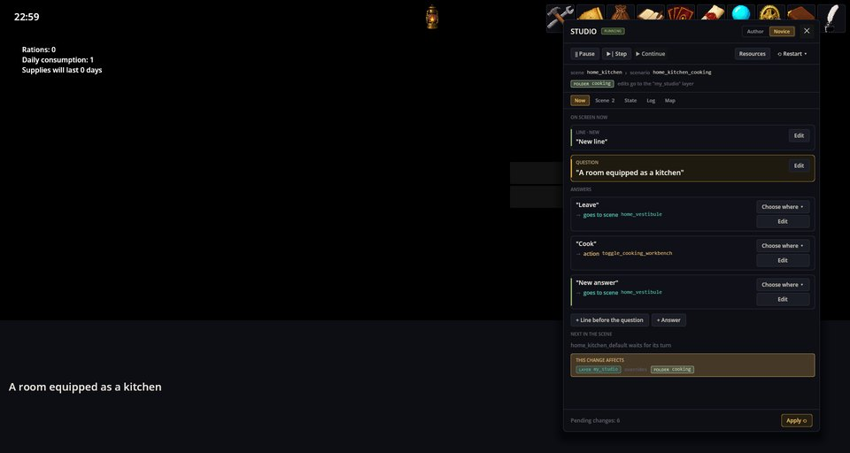
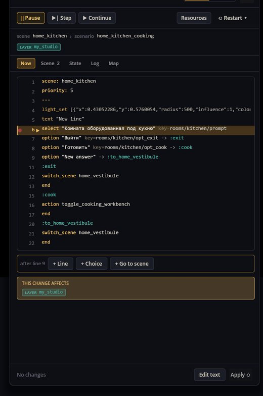

# Scenario Studio — 游戏运行时调试与编辑剧本

Scenario Studio 是一个停靠在运行中游戏旁边的面板，会显示当前播放的是哪个剧本、屏幕上正停在哪一行。它可以暂停对话、逐行单步执行、停在断点上、挪动下一行、带着回滚的游戏状态重启剧本，还能当场修改剧本——并且立刻把改动呈现到游戏里。

它有两种模式：**新手**模式用简单的块面呈现剧情时刻；**作者**模式显示带行号的剧本文本。

## 打开方式

包含 Developer Tools 工具集的游戏（机制 *Scenario Studio*）工具栏上有一个**工作室**按钮——羽毛笔。启动参数 `--studio` 会在开局时直接打开面板。下面的截图来自 Cthangover 的厨房；编辑都写进了测试层，没有碰游戏自己的文件。

## 新手模式

**现在**标签页显示屏幕上的时刻：台词、问题和每个回答的去向。**编辑**修改文本，**选择去向**修改一个回答指向哪里（某个标签、另一个场景或结尾），**+ 台词**和**+ 回答**往这个时刻里添加内容。每处修改都会在**此修改影响**里显示将写入哪个模组或哪一层。

## 作者模式：暂停与断点

- **暂停**让对话停在下一行之前；**单步**执行一行；**继续**照常往下走。
- 在边栏点一下即可设置**断点**：对话会在那一行之前停下。
- 把 **▶** 标记拖到另一行，就能让那一行成为下一行。
- **+ 台词**、**+ 选项**、**+ 前往场景**添加在当前行之后；**编辑文本**编辑整个剧本。

## 应用与重启

**应用**会写入改动并重启剧本。这里在问题前加了一行「新台词」；应用之后它已经显示在画面上：

**重启**提供几种选择：不带回滚地重跑剧本、**带状态回滚**重跑（标记、物品、时钟等都会回到剧本开始时的样子）、重进场景，或从当前标签继续。

## 检查状态

**状态**标签页按归属分组显示游戏状态：时钟、正在进行的对话的变量、剧本引用到的任务、背包，以及哪些剧本已经运行过。变量、物品数量和任务状态都可以修改（按 Enter 写入游戏），以便尝试其他分支。**场景**列出当前场景的剧本，**地图**显示各场景及其间的通路（以及可以把新背景拖放到的位置），**日志**记录发生的事情：

## 改动写到哪里

- 以文件夹形式安装的模组可以就地修改。
- 否则改动会进入游戏的**工作室层**（`user://studio/<game>`），它的优先级高于所有模组，且不会碰模组本身。这一层可以导出为新模组，再加入游戏的合集中。
- **资源**会重新读取游戏运行时拖入模组或层的 `backgrounds/` 文件夹的背景；之后可以在「地图」标签页直接用这样的背景新建场景。

## 出问题了怎么办

1. **没有工作室按钮。** 游戏的合集没包含工作室；添加 Developer Tools 工具集，或用 `--studio` 启动。
2. **单步没有反应。** 对话正在等待回答：先选一个。
3. **其他玩家看不到改动。** 工作室层里的修改只留在这台电脑的这个游戏里；把层导出为模组即可分享。
